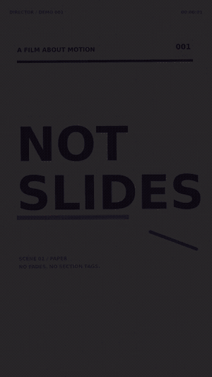

<div align="center">

# Director

**An agent skill that turns a brief into a finished HTML motion video.**
Script → audio → deterministic timeline → frame-perfect MP4.

[](#install)
[](#install)
[](LICENSE)



<sub>Five-second demo rendered from `assets/demo/index.html` by the included renderer. <a href="docs/demo.mp4">Watch the MP4</a>.</sub>

</div>

## Why

Most AI-generated video is either a slideshow or a screen recording. Director
treats the video as a deterministic timeline: audio is mixed first, captions are
timed to words, every frame is rendered from a known time, and the final MP4 is
verified before delivery.

It is a production skill, not a magic video generator. The agent writes the
animation; Director enforces the contract that makes it render correctly.

## What you get

- 9:16, 16:9, or 1:1 video
- Story beats, script, and a shootable storyboard
- Single-file `index.html` animation (Canvas / GSAP / CSS)
- VO alignment, karaoke captions, and SFX
- Frame-perfect MP4, no dropped frames
- Master + 720p preview + contact sheet + QA report
- A guard against the 32 MiB inline-media limit that kills agent sessions

## Pipeline

```text
brief → script → VO/audio → storyboard → HTML timeline → review → render → QA → delivery
```

Each phase has a gate: script/VO approved, 3–6 frame review, then full render.
The skill is designed to stop an agent from rendering 1,000 frames before anyone
has looked at the hook.

## Install

| Agent | Where |
|---|---|
| **OpenCode** | `git clone https://github.com/alwaysResa/director-skill.git ~/.config/opencode/skills/director` |
| **Claude Code** | `git clone https://github.com/alwaysResa/director-skill.git ~/.claude/skills/director` |
| **Codex CLI** | clone into your Codex skills folder, or reference `SKILL.md` from `AGENTS.md` |
| **Gemini CLI / Cursor** | copy into the project and reference `SKILL.md` from `GEMINI.md` / `.cursor/rules` |
| **Plain chat** | paste `SKILL.md` and the relevant file in `references/` |

The repo itself is the skill folder. After cloning, the agent reads `SKILL.md`
and loads only the references it needs.

> On Windows, replace `~` with `%USERPROFILE%` in PowerShell, or run the same
> commands in Git Bash.

## Quick start

```bash
git clone https://github.com/alwaysResa/director-skill.git
cd director-skill

# 1. render the 5-second demo at 1080x1920 / 24fps
node scripts/render-frames.mjs \
  --url "file://$(pwd)/assets/demo/index.html" \
  --out /tmp/director-frames \
  --width 1080 --height 1920 --fps 24 --duration 5 \
  --hide "#ui"

# 2. mux with the included tone
ffmpeg -y -framerate 24 -start_number 0 \
  -i /tmp/director-frames/f%05d.png \
  -i assets/demo/tone.m4a \
  -c:v libx264 -preset slow -crf 18 -pix_fmt yuv420p \
  -c:a aac -b:a 192k -shortest -movflags +faststart \
  demo.mp4

# 3. QA
node scripts/qa-video.mjs demo.mp4 \
  --width 1080 --height 1920 --fps 24 --duration 5
```

Or run the whole smoke test:

```bash
npm test
```

## Requirements

- **Node.js >= 22** (global `WebSocket`; no npm install needed)
- **Chromium or Google Chrome** (`CHROME_BIN` or auto-detected)
- **ffmpeg** and **ffprobe**
- **Python 3 + Pillow** only for labelled contact sheets

The renderer has no Puppeteer/Playwright dependency. It drives one Chromium
instance over the DevTools Protocol, seeks `window.__seek(t)`, waits two frames,
and captures the viewport. That is why it works on a bare Linux box with only
Chromium installed.

## The 32 MiB rule

AI agents often kill a session by attaching too many full-resolution frames.
The gateway limit is **33,554,432 bytes** of inlined media per request. Base64
inflates files by about 33%, and every earlier image is sent again on the next
step, so one batch of 20+ screenshots can brick the session.

Director ships `scripts/media-budget.mjs` and a review protocol:

- review at 360–405 px JPEG, quality 65–70
- maximum 4–6 images per message
- one contact sheet instead of 20 separate frames
- crop the caption area when checking typography
- never attach WAV/MP3/MP4 to chat

If the error already happened, start a new session and reference files by path.
Compaction often fails because it sends the same media again.

## Repo layout

```text
SKILL.md                  rules, routing, seven-phase workflow
scripts/
  render-frames.mjs       Chromium CDP renderer (zero npm dependencies)
  contact-sheet.py        labelled sheet, optional Pillow
  media-budget.mjs        raw/base64 size guard
  qa-video.mjs            ffprobe, full decode, loudness, first/last
references/               story, visual language, HTML contract, audio, QA
assets/starter/           starting point for a new video
assets/demo/              5-second demo + generated tone
docs/                     demo GIF/MP4 and contact sheet
tests/                    smoke test
extras/                   optional GitHub Actions CI template
```

## QA gates

1. Render 3–6 keyframes and one contact sheet before the full render.
2. Full decode, loudness, duration, frame count, first/last frame.
3. The user watches the final MP4 with sound. A successful encode is not
   acceptance.

To enable CI, copy `extras/github-actions-smoke.yml` to
`.github/workflows/smoke.yml` (the push token needs the `workflow` scope).

## Bahasa Indonesia

Director adalah skill agent untuk membuat video berbasis HTML dari brief sampai
MP4: script, voice-over, caption karaoke, SFX, render frame-perfect, dan QA.

1. Clone ke folder skill OpenCode:
   `git clone https://github.com/alwaysResa/director-skill.git ~/.config/opencode/skills/director`
2. Minta agent: *"Buat video 45 detik 9:16 tentang …, pakai VO ini, caption
   karaoke, lalu render MP4."*
3. Review contact sheet dulu, bukan 20 screenshot full-res.
4. Setelah approve, baru render penuh dan tonton hasilnya dengan suara.

Aturan penting: limit media inline adalah **32 MiB per request**. Jangan baca
22 frame 1080×2080 sekaligus; pakai contact sheet dan JPEG kecil.

## Credits

Director is a production-layer companion to
[bang-motion](https://github.com/bangtutorial/bang-motion) by Bang Tutorial.
Bang Motion is optional and not bundled; if it is installed, use it for visual
style direction and use Director for the render/QA pipeline.

## License

MIT © 2026 Francesa de nayra. See [LICENSE](LICENSE).
